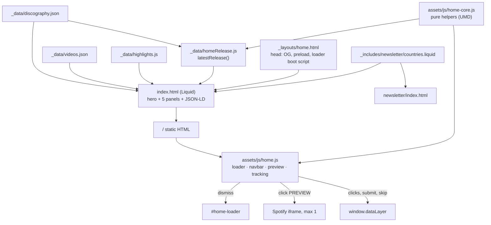

# Home Cyberpunk Design

**Spec**: `.specs/features/home-cyberpunk/spec.md`
**Context**: `.specs/features/home-cyberpunk/context.md`
**Status**: Draft

---

## Approach

| Option | Summary | Verdict |
| --- | --- | --- |
| **A. Static-first (chosen)** | Build-time Liquid renders everything from `_data/`; a `_data/homeRelease.js` computes the latest release; vanilla JS adds only the loader, navbar state, Spotify preview and `dataLayer` pushes. | Same shape as discography and videos; every link and the form work without JS; SEO sees the real content. |
| B. Client-rendered sections | Fetch the JSON in the browser and render teasers with JS. | Rejected: breaks the no-JS goal (spec Goals) and hides content from crawlers. |
| C. Eleventy image/data plugins | Add `@11ty/eleventy-img` for derivatives and computed data. | Rejected: Eleventy 0.12 in use; one hero image does not justify a new build dependency. Derivatives are generated once with ImageMagick (WebP support verified: libwebp 1.3.2) and committed. |

## Architecture Overview



The only computation that matters (which release is "latest", when the loader leaves, what event to push) lives in `home-core.js` as pure functions, loaded both by Node (the Eleventy data file and unit tests) and by the browser - the same UMD shape as `discography-core.js`.

---

## Code Reuse Analysis

### Existing Components to Leverage

| Component | Location | How to Use |
| --- | --- | --- |
| Cyber panel shell and corner spans | `discography/index.html:11-30`, `less/discography.less:47-200` | Copy the markup order and the LESS block into `#page_home`, keyframes renamed `home-*`. Includes the `overflow: hidden; overflow: clip;` pair and the `width/max-width: 100%` guard against `less/contact.less:328`. |
| Platform button system | `less/cyber-links.less` (`.cyber-link-btn`, `--primary`, per-platform colors) | Used as-is for hero and NOW::STREAMING anchors; `#page_home` is added to its scope. |
| Platform registry | `_data/platforms.json` | Iterate for NOW::STREAMING buttons, labels and icons, same loop as the discography card. |
| UMD pure-core + DOM wiring split | `assets/js/discography-core.js`, `assets/js/discography.js` | `home-core.js` + a rewritten `home.js`. |
| Spotify preview behavior | `assets/js/discography.js:20-60` | Same iframe attributes (`height=352`, `allow=...`, `title`), single instance. |
| Mailchimp form markup and styles | `newsletter/index.html:62-120`, `less/mailchimp.less` | Same `action`, field names and honeypot; the country list moves to a shared include. |
| Featured photos | `_data/highlights.js` | Direct Liquid loop, thumbnails (`thumbnail`, `alt`). |
| Test harness | `playwright.config.cjs`, `tests/discography/*.e2e.cjs`, `node:test` unit files | New `tests/home/`; config already globs `tests/**/*.e2e.cjs`. |

### Integration Points

| System | Integration Method |
| --- | --- |
| Eleventy 0.12 JS data files | `_data/homeRelease.js` exports the latest release object; exposed as `homeRelease`. Same mechanism as `_data/highlights.js`. |
| Cache-busting transform (`.eleventy.js:31`) | `/assets/js/home*.js` and `style.min.css` get `?v=<hash>` automatically. |
| GTM (`GTM-WW9HZGP`) | `window.dataLayer.push` from `home.js`; tags configured in GTM. |
| `/videos/#<slug>` deep links | Already handled by `videos.js:163` (`indexFromHash`). |
| `/discography/#<slug>` anchors | Release cards carry `id="<slug>"` (`discography/index.html:36`). |

---

## Components

### `assets/js/home-core.js` (new, UMD `window.IDHome`)

- **Purpose**: Pure, DOM-free decisions for the home.
- **Interfaces**:
  - `latestRelease(catalog: {albums, singles}): Release | null` - max `releaseDate`; album wins a tie; `null` on empty. (HOME-09)
  - `spotifyAlbumId(release): string | null` - `spotifyId`, else the id parsed from `links.spotify` matching `open.spotify.com/album/<id>`, else `null`. (HOME-18)
  - `spotifyEmbedUrl(id): string | null`
  - `loaderDismissAt({ startedAt, readyAt, repeat }): number` - ms timestamp to dismiss. Repeat: `startedAt + 400`. First: `min(startedAt + 3500, max(startedAt + 1200, readyAt ?? Infinity))`. (HOME-22/23/24)
  - `isRepeatVisit(storage): boolean` - reads `id-home-booted`; returns `false` when storage is missing or throws. `markVisited(storage)` swallows errors. (HOME-24/25)
  - `navIsSolid(scrollY: number): boolean` - `scrollY > 40`. (HOME-36/37)
  - `releaseClickEvent(platform, slug, placement)`, `teaserClickEvent(target, slug?)`, `newsletterEvent()`, `loaderSkipEvent()` - event objects. (HOME-49/50/47/26)
  - `releaseTypeLabel(release)` - `ALBUM` / `DELUXE EDITION` / `SINGLE`. (HOME-10)

### `_data/homeRelease.js` (new)

- **Purpose**: Expose the latest release to Liquid, decorated with `typeLabel` (round 7 dropped `embedId` and `detailUrl`: nothing read them, HOME-69).
- **Interfaces**: `module.exports = () => ({ ...latestRelease(require('./discography.json')), typeLabel })`.
- **Reuses**: `home-core.js` via `require('../assets/js/home-core.js')`.

### `_layouts/home.html` (rewritten)

- **Purpose**: Page frame for `/` only.
- **Head**: existing includes (GTM, pixel, metatags, styles, analytics); `<link rel="canonical" href="/">`; OG + Twitter meta (HOME-53); `<link rel="preload" as="image" imagesrcset=... imagesizes="100vw">` for the hero WebP; an inline boot script (≤ 10 lines) that adds `home-js` and `home-loading` to `<html>` before first paint (HOME-20/21).
- **Body**: `#home-loader` markup (hidden by CSS unless `html.home-loading`), menu include, `{{ content }}`, footer include, `jspath` include. No `please-wait`, no Owl, no `.page-header`, no `#content` bodybg wrapper around the hero.
- **Removed**: `please-wait` script and config, `#owl-demo`, the logo `h1`.

### `index.html` (rewritten)

Sections in DOM order:

| Section | Markup hooks | Contents |
| --- | --- | --- |
| Hero | `<section class="home-hero" data-home-hero>` | `<picture>` (WebP + JPG `srcset` 768/1280/1920, `fetchpriority="high"`, no `loading`); overlay layers `.home-hero-grid`, `.home-hero-scan`, `.home-hero-vignette` (`aria-hidden`); `h1.home-title` with `` and a glitch pseudo-layer; tagline `p.home-tagline`; `.home-release-card` with cover, `typeLabel // year`, title, Spotify + Apple anchors (`data-home-link`, `data-home-placement="hero"`); scroll cue. |
| Zone | `.home-shell.cyber-zone > .cyber-zone-inner` | Wraps all panels. |
| NOW::STREAMING | `.cyber-panel`, `data-hud="SIGNAL.<SLUG> // STREAMING_"` | Cover, title, all platform anchors present (`placement="streaming"`), detail link, `PREVIEW` button `[data-home-preview-btn][hidden]`, empty `[data-home-preview]`. |
| ID-TV::LATEST | `data-hud="TRANSMISSION.LATEST // <TYPE>_"` | Anchor `[data-home-teaser="video"]` to `/videos/#<slug>` with poster and title. |
| DISC::ARCHIVE | `data-hud="CATALOG // 03 ALBUMS_"` | Grid of 3 album anchors `[data-home-teaser="album"]`. |
| VISUAL::FEED | `data-hud="VISUAL.FEED // 06 FRAMES_"` | Mosaic of 6 thumbnails; one `[data-home-teaser="photos"]` anchor wraps the grid CTA. |
| SIGNAL::NEWSLETTER | `data-hud="FORM.READY // AWAITING_"` | Mailchimp form (`EMAIL`, `COUNTRY` via include, honeypot, submit). |
| JSON-LD | `<script type="application/ld+json">` | `MusicGroup` (HOME-52). |

### Loader (`#home-loader` in `home.html`, logic in `home.js`, styles in `home.less`)

```
┌────────────────────────────────────────────┐
│ ░ scanlines ░                   SYS v2.0 ▌ │
│                                            │
│           [ INSANE DRIVER logo ]           │  ← RGB split: two tinted copies (cyan/magenta)
│                                            │     offset in `home-glitch` keyframes
│  > INITIALIZING INSANE_DRIVER.SYS ...  OK  │  ← lines revealed by staggered animation-delay
│  > LOADING NEURAL AUDIO CORE ......... OK  │
│  > SYNCING TRANSMISSION FEED ........ OK   │
│  [██████████████░░░░░░░░]  62%             │  ← width driven by JS from elapsed/expected
│                    CLICK OR ESC TO SKIP    │
└────────────────────────────────────────────┘
```

- `role="status"`, `aria-label="Loading Insane Driver"`; while visible `main` gets `inert` (HOME-28).
- Dismiss: add `.is-done` (opacity/clip-path exit, 350ms; 200ms opacity under reduced motion), then set `hidden` and remove `home-loading` from `<html>` on `transitionend` or a 450ms fallback timer (HOME-27).
- Ready signal: `Promise.all([heroImg.decode() or load/error, document.fonts ? document.fonts.ready : resolved])` - an image error counts as ready so the cap is never the only exit.
- Timer: `setTimeout(dismiss, dismissAt - now)` recomputed once when the ready promise resolves; a separate hard `setTimeout(dismiss, 3500)` guarantees the cap (HOME-23).
- If `home.js` fails to load, a CSS-only safety net fades the loader out after 4s (`animation: home-loader-failsafe 0s 4s forwards`), so a broken script can never trap the page.

### Navbar (home only)

- `#page_home .navbar` becomes `position: fixed; top:0; width:100%; background: transparent` with a gradient scrim for legibility; `.is-solid` sets `rgba(3,8,14,.92)` plus `backdrop-filter: blur(8px)` and a cyan hairline.
- `home.js` toggles `.is-solid` from `navIsSolid(scrollY)` on a passive `scroll` listener throttled with `requestAnimationFrame`, and once on load (edge case: restored scroll).
- The legacy `#page_home .nav-logo { display:none }` rule (desktop) is kept - the hero `h1` already shows the logo.
- Mobile: the collapsed menu opens over the hero; `.navbar-collapse.in` gets the solid background regardless of scroll.

### Hero visual stack (z-order, bottom to top) - HOME-07

| Layer | z-index | Notes |
| --- | --- | --- |
| `<picture>` photo | 0 | `object-fit: cover; object-position: center 30%`; subtle `home-drift` scale 1 -> 1.06 over 20s |
| `.home-hero-vignette` | 1 | radial black vignette + bottom fade into `#03080e` |
| `.home-hero-grid` | 2 | perspective neon floor grid (cyan, 12% opacity) scrolling via `home-grid` |
| `.home-hero-scan` | 3 | repeating-linear-gradient scanlines + occasional `home-sweep` bar |
| `.home-hero-content` | 4 | `h1`, tagline, release card |

Desktop: content bottom-left, release card bottom-right. Below 768px: stacked - logo, tagline, card - centered, `padding-top` clears the fixed navbar; card width `min(100%, 22rem)` so it fits 375x667 (HOME-13).

### `_includes/newsletter/countries.liquid` (new)

- **Purpose**: The `<option>` list, moved verbatim from `newsletter/index.html`.
- **Consumers**: `newsletter/index.html` (replaces the inline list) and `index.html`.

### Styles

- `less/home.less`: rewritten, all rules under `#page_home`; sections for loader, hero, navbar, zone/panels (copied from discography with `home-` keyframes), teasers, newsletter tweaks, reduced-motion block (`animation: none !important` for every `home-*` user, loader shortened). No `@import` of another page's file.
- `less/cyber-links.less`: add `#page_home` to the selector list that scopes the button system.

### Scripts

- `_includes/js/home.liquid`: `` + `home-core.js` + `home.js` (drops `insane.js` and `videos.js`, which only served the YouTube players - verified in Tasks before removal).
- `home.js` modules (one IIFE): `loader()`, `navbar()`, `preview()`, `tracking()`. Each bails out quietly when its hook is absent.

---

## Data Models

```ts
// _data/homeRelease.js output
interface HomeRelease {
  slug: string; title: string; year: number; releaseDate: string; // 'YYYY-MM-DD'
  cover: string; coverWidth: number; coverHeight: number;
  type: 'ALBUM' | 'DELUXE' | 'SINGLE';
  links: Record<PlatformKey, string | null>;
  typeLabel: 'ALBUM' | 'DELUXE EDITION' | 'SINGLE';
}

// dataLayer events
{ event: 'home_release_click', platform: string, release: string, placement: 'hero' | 'streaming' }
{ event: 'home_teaser_click', target: 'video' | 'album', slug: string }
{ event: 'home_teaser_click', target: 'photos' }
{ event: 'home_newsletter_submit' }
{ event: 'home_loader_skip' }
```

Hero image derivatives (committed): `assets/images/home/hero-{768,1280,1920}.{webp,jpg}`.

---

## Error Handling Strategy

| Error Scenario | Handling | User Impact |
| --- | --- | --- |
| Hero image fails | `error` resolves the ready promise; hero background is `#03080e` with the vignette | Dark hero, text readable, loader leaves on time |
| `document.fonts` missing | Treated as resolved | None |
| `sessionStorage` throws | `isRepeatVisit` returns `false` | Full boot, still capped at 3.5s |
| `home.js` 404 or throws | CSS failsafe animation hides the loader at 4s; links and form are plain HTML | Page usable; no preview/tracking |
| JavaScript disabled | `home-loading` never set; loader `display:none`; `PREVIEW` stays `hidden` | Hero shows immediately |
| Spotify embed fails | Iframe shows its own error; anchors unaffected | Can still click out |
| `dataLayer` missing | `window.dataLayer = window.dataLayer || []` before push | None |
| No release found | `homeRelease` returns `null`; Liquid skips the card and NOW::STREAMING | Hero without card |

---

## Risks & Concerns

| Concern | Location (file:line) | Impact | Mitigation |
| --- | --- | --- | --- |
| Unscoped `.cyber-zone-inner { max-width }` leaks site-wide | `less/contact.less:328` | Home panels capped at 560px | Same `width/max-width: 100%` guard discography uses (`less/discography.less:86`). |
| `overflow: hidden` on cyber zones strands in-page anchors | `less/discography.less:50-58` (comment) | Scroll trap | Copy the `hidden` then `clip` pair; HOME-34 e2e asserts computed `overflow-y` is `clip`/`visible`. |
| Owl carousel CSS/JS loaded site-wide via `js/pack` and `insane.js` | `_includes/js/pack.liquid:3`, `assets/js/insane.js` | Dead weight on the home | Out of scope to remove site-wide; home simply renders no `.owl-carousel`. |
| `#content` background `bodybg.jpg` | `less/general.less:14` | Would sit behind the hero | Hero is outside `#content`; the zone keeps the backdrop like other pages. |
| Global `.navbar-inverse { background: black }` | `less/header.less:1` | Beats the transparent state | Home override scoped under `#page_home` with higher specificity; HOME-38 e2e checks `/band/` computed background stays `rgb(0, 0, 0)`. |
| Country list extraction touches `/newsletter/` | `newsletter/index.html:88-340` | Silent option drift | HOME-46 e2e compares option values between pages and a snapshot count. |
| No unit tests exist for the home today | `tests/` | Nothing guards the legacy page | New `tests/home/` suite; old behavior is intentionally removed. |
| `please-wait` gave a cover for FOUC | `_layouts/home.html` | Flash of unstyled hero | Stylesheet stays render-blocking in `<head>`; loader boot class set by inline script before `<body>`. |

---

## Tech Decisions

| Decision | Choice | Rationale |
| --- | --- | --- |
| Latest-release computation | Build time in `_data/homeRelease.js`, reusing `home-core.js` | Static HTML carries the right release; one function tested in Node. |
| Loader visibility gate | Inline script adds `html.home-loading`; CSS shows the loader only under that class | Guarantees absence without JS and before-first-paint presence with JS. |
| Loader failsafe | Pure-CSS 4s fade under `html.home-loading` | A script failure cannot trap the page. |
| Hero derivatives | ImageMagick once, committed | No new build dependency on Eleventy 0.12. |
| Hero image priority | `<link rel=preload imagesrcset>` + `fetchpriority="high"` | Loader waits on this image; it must start first. |
| Navbar on home | `position: fixed` + `.is-solid` class | Hero owns the viewport; class toggle is cheap and testable. |
| Glitch effect | Two `::before/::after` copies of the logo via CSS `background-image`, `clip-path` bands animated | No canvas, no JS, disabled cleanly by reduced motion. |
