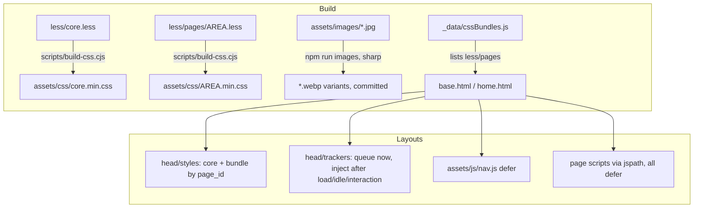

# Perf PageSpeed Design

**Spec**: `.specs/features/perf-pagespeed/spec.md`
**Status**: Approved

---

## Architecture Overview

Three layers, matching the spec's scope: a shared core every page gets, the two layouts (`base.html`, `home.html`), and page-area bundles. Nothing new runs at request time; every change is build output or markup.

### Approach chosen for the CSS pipeline

| Approach | Trade-off | Verdict |
| -------- | --------- | ------- |
| **A. Node script on the `less` API** (`scripts/build-css.cjs`) compiling `less/core.less` and each `less/pages/*.less` with `compress: true`; `--watch` mode via `fs.watch` | One small script, no new dependency (`less` is already a devDependency), bundle list derived from the folder | **Chosen** |
| B. One `less-watch-compiler` run per entry | Needs a config file per bundle and N watchers | Rejected |
| C. Compile one file and split it afterwards by selector | Fragile parsing of minified CSS | Rejected |

Bundle selection: `_data/cssBundles.js` returns the area names found in `less/pages/`. The layout links `/assets/css/{{ page_id }}.min.css` only when `cssBundles contains page_id`. No front matter changes. `page_id: discography` already covers release and song pages; `reward` has no bundle and gets core only.

---

## Code Reuse Analysis

### Existing Components to Leverage

| Component | Location | How to Use |
| --------- | -------- | ---------- |
| Cache busting transform | `.eleventy.js:24` | Already hashes any `/assets/*.css|js` reference, so the new bundles and `nav.js` get `?v=` automatically |
| `#page_<id>` scoping | every `less/<area>.less` | Each page file is one `#page_<id> { … }` block, so moving it into its own bundle changes no selector |
| `.cyber-links-system()` mixin | `less/cyber-links.less` | Outputs nothing by itself; imported (reference) by the home, band and discography bundles |
| Hero `<picture>` pattern | `index.html:16`, `_layouts/home.html` preload | Same markup shape and 768/1280/1920 widths for the inner-page headers |
| Font fixtures | `tests/home/fonts/*.woff2`, `tests/home/helpers.cjs` | The helper routes Google Fonts; after self-hosting it becomes a no-op, and the same families must still resolve |
| Built-site unit tests | `tests/seo/*.test.cjs` read `docs/` | Same style for the new `tests/perf/*.test.cjs` (CI already builds before unit tests) |

### Integration Points

| System | Integration Method |
| ------ | ------------------ |
| `package.json` scripts | `less:build` → `node scripts/build-css.cjs`; `watch` uses `--watch`; new `images` script |
| `dates/index.html` (out of scope) | Its one `<link>` to `style.min.css` is repointed to `core.min.css`, because `style.min.css` is no longer emitted. No other change to the page |
| GTM container | Unchanged. Events pushed to `window.dataLayer` before `gtm.js` loads stay in the array and are processed when it does |

---

## Components

### CSS build (`scripts/build-css.cjs`)

- **Purpose**: Compile `less/core.less` and `less/pages/*.less` into minified `assets/css/<name>.min.css`.
- **Location**: `scripts/build-css.cjs`, `less/core.less`, `less/pages/<area>.less`
- **Interfaces**:
  - `node scripts/build-css.cjs` - one-shot build, exits non-zero on a Less error
  - `node scripts/build-css.cjs --watch` - rebuilds on any change under `less/`
- **Contents**:
  - `core.less` imports bootstrap (Glyphicons rules and `@font-face` removed), font-awesome (`font-display: swap` added), fonts (new self-hosted faces), insane-font, typography, general, header and footer.
  - `blog.less` is dropped: no page uses `.blog-*`.
  - `owl.less` is deleted.
  - `pages/<area>.less` imports `../<area>.less` plus `(reference) ../cyber-links.less` where the mixin is used. `photos` also imports `photoswipe.less`.
- **Dependencies**: `less` (existing devDependency)
- **Reuses**: the current Less files, moved as they are

### Font faces (`less/fonts.less`, `assets/fonts/`)

- **Purpose**: Self-host Rajdhani 500/600/700 and Share Tech Mono 400 (latin) and serve SiliconFont as woff2.
- **Location**: `less/fonts.less`, `assets/fonts/rajdhani-{500,600,700}.woff2`, `share-tech-mono-400.woff2`, `Mars-Mission.woff2`
- **Interfaces**: `@font-face` with `font-display: swap`. The latin `unicode-range` is copied from the Google CSS. SiliconFont uses `src: url(Mars-Mission.woff2) format('woff2'), url(Mars-Mission.ttf) format('truetype')`.
- **Dependencies**: Files downloaded once from the Google Fonts CSS (latin subset) and `fonttools ttLib.woff2 compress` for Mars-Mission. Both are committed outputs, so nothing runs at build time.

### Head styles (`_includes/head/styles.liquid`)

- **Purpose**: Link core + page bundle and preload only the icon font.
- **Interfaces**:
  - `<link rel="preload" as="font" crossorigin href="/assets/fonts/fontawesome-webfont.woff2?v=4.4.0">`
  - `<link rel="stylesheet" href="/assets/css/core.min.css">`
  - `<link rel="stylesheet" href="/assets/css/{{ page_id }}.min.css">`
- The Google Fonts `preconnect` and stylesheet go away, along with the Glyphicons and Mars-Mission preloads.

### Trackers (`_includes/head/trackers.liquid`)

- **Purpose**: Queue analytics at parse time and fetch the scripts after first render.
- **Location**: replaces `head/gtm.liquid`, `head/fbpixel.liquid` and `head/analytics.liquid` (the UA tag is deleted). `gtm-noscript.liquid` and the Pixel `<noscript>` stay.
- **Interfaces** (inline script, ES5 like the other inline scripts):
  - At parse time: `dataLayer.push({'gtm.start': …, event: 'gtm.js'})`, the standard `fbq` stub, `fbq('init', …)` and `fbq('track', 'PageView')`.
  - `load()` runs once (guarded by a flag). It appends async `<script>` tags for `gtm.js?id=GTM-WW9HZGP` and `fbevents.js` and removes the interaction listeners.
  - Triggers:
    - `window` `load` → `requestIdleCallback(load, {timeout: 2000})`, or `setTimeout(load, 2000)` when `requestIdleCallback` is missing
    - the first `pointerdown`/`keydown`/`scroll`/`touchstart` (passive, capture) → `load()`
- **Reuses**: the GTM and Pixel snippets, with only the injection moved out of them.

### Mobile menu (`assets/js/nav.js`)

- **Purpose**: Replace Bootstrap's collapse on `.navbar-toggle` and `#navbar`.
- **Interfaces**: a click on `[data-toggle="collapse"]` toggles the `in` class on its `data-target`, flips `aria-expanded`, and toggles `collapsed` on the button. The Bootstrap 3 CSS already shows `.navbar-collapse.in` below 768 px and always shows it at 768 px and above, which covers PERF-40.
- **Dependencies**: none. It is its own `defer` file loaded by both layouts, so an error in a page script cannot stop it (PERF-12).
- **Note**: Bootstrap's 350 ms height animation (`.collapsing`) is not reproduced. The menu opens instantly.

### Scripts per page (`_includes/js/*.liquid`)

- `pack.liquid` and `insane.liquid` are deleted.
- `band`, `newsletter` and `pre-save` drop `jspath: js/pack`. `store` and `contact` drop `jspath: js/insane`.
- The other includes drop `` and add `defer` to every tag. Order is kept, so photoswipe still loads before `photoswipe-impl`.
- `spotify-select-playlist.liquid` keeps only `jquery.min.js` and its own script, both `defer`.

### Image pipeline (`scripts/images.cjs`)

- **Purpose**: Generate committed WebP variants.
- **Interfaces**: `npm run images`. A manifest in the script lists the source, widths and output names:
  - `header_1..7.jpg` → `header_N-{768,1280,1920}.webp`
  - `band.jpg` → `band-{768,1280,1920}.webp`
  - `bodybg.jpg` → `bodybg.webp`
  - `footer.jpg` → `footer.webp`
  - each home cover in `releases/` → `<name>.webp` at its native size
- `sharp` encodes at quality 78, effort 6, with metadata stripped. A file is skipped when its output is newer than its source, and the same sharp version produces identical bytes (PERF-25).
- The manifest is exported, so `tests/perf/images.test.cjs` can check that every variant exists (PERF-31).
- **Dependencies**: `sharp` (new devDependency)

### Markup changes

- `base.html` header: `<picture><source type="image/webp" srcset="…-768.webp 768w, …-1280.webp 1280w, …-1920.webp 1920w" sizes="100vw"></picture>`. The base name comes from `header_img_path | replace: '.jpg', ''`.
- `band/index.html` photo: `<picture>` with the band WebP srcset, `width="1920" height="1280" loading="lazy" decoding="async"`.
- Home covers (`index.html:40,76,157`): wrapped in `<picture>` with a WebP source. The latest-release cover above the fold stays eager; the other two keep `loading="lazy"`.
- `logo_horizontal.png` in the menu: `width="600" height="95" loading="lazy"`, because it is hidden in the collapsed mobile menu.
- `general.less`, `footer.less` and `home.less:673`: `background-image: url(x.jpg); background-image: image-set(url(x.webp) type("image/webp"), url(x.jpg) type("image/jpeg"));`

### Loader timing

- `home-core.js`:
  - `LOADER_MIN` 1200 → 600
  - `LOADER_MAX` 3500 → 1500
  - `LOADER_FAILSAFE` 4000 → 2000
- `home.less:1410` and `:1585`: failsafe delay `4s` → `2s`.
- `_layouts/home.html` inline script: `+ 4000` → `+ 2000`.
- `LOADER_REPEAT` stays at 400.

---

## Error Handling Strategy

| Error Scenario | Handling | User Impact |
| -------------- | -------- | ----------- |
| Tracker host blocked or down | Scripts load after `load`, so nothing waits on them | None |
| No `requestIdleCallback` (Safari < 16.4) | `setTimeout(load, 2000)` after `load` | None |
| Page script throws | `nav.js` is a separate file | Menu still works |
| Browser without WebP | `` JPEG fallback and the first `background-image` declaration | Same image, larger bytes |
| Less compile error | `build-css.cjs` exits 1, so the build and CI fail | No broken deploy |
| `home.js` never runs | CSS failsafe and inline script release the page at 2 s | Page usable at 2 s instead of 4 s |

---

## Risks & Concerns

| Concern | Location (file:line) | Impact | Mitigation |
| ------- | -------------------- | ------ | ---------- |
| `bootstrap.less` and `font-awesome.less` are minified vendor dumps, edited by hand | `less/bootstrap.less:5`, `less/font-awesome.less` | A bad edit can break unrelated rules | Remove only the `.glyphicon*` rules and the Glyphicons `@font-face`, and add `font-display`. The unit test asserts that those strings are absent and the theme e2e suites stay green |
| `dates/index.html` hard-links `style.min.css` | `dates/index.html:45` | Unstyled page once `style.min.css` is gone | Repoint the link to `core.min.css` (one line) |
| Legacy test reads `style.min.css` | `tests/home/legacy.test.cjs:19` | The test breaks | Point it at the bundle that holds what it checks (home or core), keeping its assertion |
| Layout test looks for a `style.min.css` link | `tests/home/layout.e2e.cjs:36` | The test breaks | Point it at `core.min.css`, keeping what it asserts |
| Loader timing tests were already flaky (HOME-23/24/29) | `tests/home/loader.e2e.cjs` | Tighter bounds may make them flakier | Change only the bounds. If flakiness gets worse, raise it in Execute instead of loosening the assertions |
| Tracking e2e tests read `window.dataLayer` | `tests/home/tracking.e2e.cjs:9`, `tests/discography/tracking.e2e.cjs` | Need the array to exist at parse time | `trackers.liquid` creates `dataLayer` inline at parse time, as today |
| Bootstrap collapse animation lost | `_includes/header/menu.liquid:4` | The mobile menu opens instantly instead of sliding | Accepted as the only visible change besides the loader. Called out to the user |
| `insaneFont` was a 157 KB base64 data URI in `insane-font.less` | `less/insane-font.less` | Inlined, it alone pushed core past 200 KB (PERF-17) | Extracted to `assets/fonts/War-is-Over.woff2` + `.woff` (SPEC_DEVIATION marker in the file) |
| `contact.less` had 37 unscoped `.cyber-*` rules after a stray `}`, so every page got them | `less/contact.less` | Moving contact into its bundle would unstyle the cyber panels on other pages | Moved verbatim to `less/cyber-global.less`, imported by `core.less` |
| `.navbar` `border-radius: 0` (≥768 px) lived in `blog.less`, so the split would confine it to the blog bundle | `less/header.less:56` | Bootstrap's rounded navbar corners would return on every other page | Moved from `blog.less` to `header.less` (core) |
| `.cyber-band-photo` got `width`/`height` attributes (PERF-28, T15) | `less/band.less:325` | The `height` attribute stretched the photo | `height: auto` on `.cyber-band-photo` keeps the original box |
| `band.less`/`contact.less` have no `prefers-reduced-motion` | memory: cyberpunk theme system | Infinite animations cost CPU | Out of scope. The CSS moves into its bundle unchanged |

---

## Tech Decisions (only non-obvious ones)

| Decision | Choice | Rationale |
| -------- | ------ | --------- |
| Bundle key | `page_id`, filtered by `_data/cssBundles.js` | Zero front matter edits; a new `less/pages/x.less` is picked up automatically |
| Tracker loader | Inline in `<head>` | Must queue before any page script pushes events; avoids an extra request |
| Menu script | A standalone `nav.js` loaded by the layouts, not by `jspath` | Every page needs it; isolation covers PERF-12 |
| Self-hosted font source | Google's latin woff2 files, committed | Same glyphs the site renders today, with no build step |
| WebP for backgrounds | `image-set()` with `type()` after a plain `url()` | The plain declaration covers browsers without `image-set` |
| `style.min.css` | No longer emitted; the old file is deleted | A stale full bundle would hide regressions |
