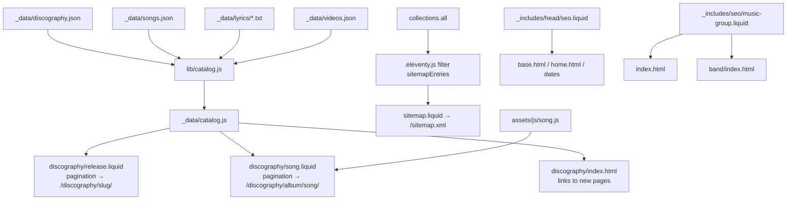

# SEO Discovery Design

**Spec**: `.specs/features/seo-discovery/spec.md`
**Status**: Approved

---

## Approaches considered

| | Approach | Trade-off |
| - | -------- | --------- |
| **A (chosen)** | Song metadata in `_data/songs.json`, lyrics as plain `.txt` files in `_data/lyrics/`, a pure build-time module `lib/catalog.js` that joins them with `discography.json`, and two Liquid pagination templates (`discography/release.liquid`, `discography/song.liquid`). | Same pattern as `_data/homeRelease.js` + `home-core.js`: the logic is a pure module tested with `node --test`, templates only render. Lyrics text stays raw, so the JSON-LD `lyrics.text` and the visible lyrics come from one string. |
| B | One Markdown template per song under `discography/<album>/<song>.md` with front matter. | Eleventy-native, but the lyrics go through the Markdown renderer (line breaks and `[Verse]` labels need escaping), the JSON-LD needs the raw text again, and 22 files duplicate the album and track facts already in `discography.json`. |
| C | Generate the pages with a Node script before Eleventy. | A second build step and generated files in the repo; no gain over pagination. |

---

## Architecture Overview



---

## Code Reuse Analysis

### Existing Components to Leverage

| Component | Location | How to Use |
| --------- | -------- | ---------- |
| Release catalog | `_data/discography.json` | Single source for titles, years, covers, tracklists, durations and platform links. Not changed. |
| Platform list | `_data/platforms.json` | Order, names and icons of streaming links on release and song pages. |
| Platform link buttons | `discography/index.html:43-61` (`cyber-link-btn`) | Same markup and classes on release and song pages; extracted to `_includes/discography/links.liquid` and reused by the index. |
| Album JSON-LD | `discography/index.html:85-101` | Same shape for the release page `MusicAlbum`, with `url` pointing to the release page and `track[].url` to song pages. |
| Data module pattern | `_data/homeRelease.js` (`build()` exported for tests) | `_data/catalog.js` exports the data function and `build()`. |
| Video helpers | `assets/js/videos-core.js` (`watchUrl`, `posterUrl`) | Reused by `song.js` for the facade; the embed host `https://www.youtube-nocookie.com` matches `assets/js/videos.js:23`. |
| Cyberpunk panels | `.cyber-zone` / `.cyber-panel` (memory: shared pattern) | Release and song pages use the same panel frame as `/discography/`. |
| Hermetic browser fixture | `tests/photos/browser.cjs` | Aborts every non-local request; used by all new e2e tests (SONG-12 relies on it to prove no YouTube request). |

### Integration Points

| System | Integration Method |
| ------ | ------------------ |
| Eleventy 0.12 | Pagination with `size: 1` and a Liquid `permalink` per item; a `sitemapEntries` filter registered in `.eleventy.js`; `robots.txt` added to the passthrough copy (today it is never copied to `docs/`). |
| `base.html` / `home.html` | The inline canonical and OG tags are replaced by ``. |
| `/discography/` | The index template gets links; markup otherwise unchanged so DISC-* tests keep passing. |

---

## Components

### `lib/catalog.js` (pure, build-time only)

- **Purpose**: Join releases, song metadata, lyrics and videos into the page models for release and song pages.
- **Location**: `lib/catalog.js` (new top-level folder, added to `.eleventyignore`; not under `assets/`, so it is not published, and not under `_data/`, so Eleventy does not execute it as data).
- **Interfaces**:
  - `songKey(title: string): string` - strips `(Deluxe Version)`, `(Acoustic Version)`, `(Acoustic)` and kebab-cases (`"Tide of Fears (Acoustic Version)"` → `tide-of-fears`).
  - `build({ discography, songs, lyrics, videos }): { songs: SongPage[], releases: ReleasePage[], links: { [releaseSlug]: { page?: url, tracks: { [position]: url } } } }`.
  - Throws `Error("seo-discovery: <song> has no lyrics file and is not instrumental")` (LYR-05) and `Error("seo-discovery: <song> references unknown album/track")` (LYR-04).
- **Dependencies**: none (plain data in, plain data out).
- **Reuses**: the slug style of `discography.json`.

### `_data/catalog.js`

- **Purpose**: Load the four sources from disk and return `lib/catalog.js`'s `build()` result as the global `catalog` data.
- **Location**: `_data/catalog.js`
- **Reuses**: `_data/homeRelease.js` pattern.

### `_data/songs.json` and `_data/lyrics/`

- **Purpose**: Curated song facts and the lyrics text (see Data Models).
- **Location**: `_data/songs.json`, `_data/lyrics/<album-slug>/<song-slug>.txt`. Eleventy only loads `.json`/`.js` from `_data/`, so the `.txt` files are read by `_data/catalog.js`, not by the cascade.

### `scripts/convert-lyrics.py` (one-off)

- **Purpose**: Convert the 21 `.docx` files to `.txt` (stdlib `zipfile` + regex on `word/document.xml`, no new dependency), drop the title and `Tema:` lines, collapse runs of blank lines to one, write `_data/lyrics/...`.
- **Location**: `scripts/` (already in `.eleventyignore`). Kept in the repo so LYR-01 can be re-checked against the originals in `../lyrics-originals/`.

### `discography/release.liquid` and `discography/song.liquid`

- **Purpose**: Render one page per `catalog.releases` / `catalog.songs` item.
- **Location**: `discography/`
- **Interfaces**: front matter `pagination: { data: catalog.songs, size: 1, alias: song }`, `permalink: "discography/{{ song.album.slug }}/{{ song.slug }}/index.html"`; release: `permalink: "discography/{{ release.slug }}/index.html"`. Both use `layout: base.html` with `page_title`, `page_description`, `og_image` computed in front matter via `eleventyComputed` (supported since Eleventy 0.11).
- **Reuses**: panel markup, `_includes/discography/links.liquid`, `discography.less`.

### `_includes/head/seo.liquid`

- **Purpose**: One place for title, description, robots, absolute canonical (`https://insanedriver.com.br{{ page.url }}`), OG and Twitter tags. Replaces `head/title`, `head/metatags` description/robots lines, and the inline canonical/OG in `base.html` and `home.html`.
- **Interfaces**: reads `page_title`, `seo_title` (optional full override), `page_description`, `page_robots`, `og_image` (default hero), `og_type` (default `website`; `music.song` / `music.album` on new pages).

### `_includes/seo/music-group.liquid`

- **Purpose**: The `MusicGroup` JSON-LD block (GEN-01..03), moved out of `index.html` and included on `/` and `/band/`.

### `_includes/seo/fans-of.liquid`

- **Purpose**: The visible line `For fans of Alter Bridge, Killswitch Engage and Avenged Sevenfold` (GEN-05), styled as a small eyebrow line, included on home, band, release and song pages.

### `sitemap.liquid` + `sitemapEntries` filter

- **Purpose**: Emit `/sitemap.xml` (SEO-01, SEO-02).
- **Location**: `sitemap.liquid` (permalink `sitemap.xml`), filter in `.eleventy.js` delegating to `lib/sitemap.js` (pure, unit-tested).
- **Rule**: keep an item when `outputPath` ends in `.html`, `data.sitemap !== false`, and `data.page_robots` contains neither `noindex` nor `nofollow`. `/preorder/`, `/pre-save/` and `/reward/*` get `sitemap: false` in front matter. `google*.html` are passthrough copies and never in `collections.all`.

### `robots.txt`

- **Purpose**: SEO-03. Static file at the root, added to `addPassthroughCopy`.

### `assets/js/song.js`

- **Purpose**: Video facade (SONG-13). On click of `[data-song-video]` (an `<a href="watch URL">`), prevent navigation and replace it with `<iframe src="https://www.youtube-nocookie.com/embed/<id>?autoplay=1" title="<video title>" allow="autoplay; encrypted-media; picture-in-picture" allowfullscreen>`.
- **Reuses**: `IDTV.watchUrl` / `posterUrl` naming; loaded via `jspath`.

---

## Data Models

### `_data/songs.json`

```typescript
interface Song {
  slug: string            // "faceless-demons"; must equal songKey(track.title)
  album: string           // "silicon-fortress" | "insane-driver" (album of first appearance)
  instrumental?: true     // Endless Path, Back to 1994
  about?: string          // 2-3 sentences, English, rewritten (never Bandcamp verbatim)
}
// Title, position, duration come from discography.json via album + slug.
// Lyrics come from _data/lyrics/<album>/<slug>.txt.
```

### Lyrics file format (`.txt`)

```
[Verse 1]
I hear their voices come to me
And they are whispering that I'm nothing

[Chorus 1]
...
```

Sections are separated by one blank line; a line matching `^\[.+\]$` is a section label. The song page renders each section as a `<section>` with an `<h3>` (label without brackets) and the lines joined with `<br>`. Lines before the first label form an unlabelled section.

### `videos.json` addition

```typescript
interface Video { id: string; slug: string; title: string; type: string; uploadDate?: string /* YYYY-MM-DD */ }
```

### Page models (output of `build()`)

```typescript
interface SongPage {
  slug: string; title: string; url: string            // "/discography/silicon-fortress/faceless-demons/"
  album: { slug: string; title: string; year: number; url: string; cover: string; links: Links }
  position: number; duration: number                   // seconds
  instrumental: boolean
  sections: { label: string | null; lines: string[] }[] // empty when instrumental
  lyricsText: string                                   // plain text for JSON-LD
  about: string | null
  video: Video | null
  alsoReleasedAs: { title: string; year: number; links: Links; url: string | null }[]
  prev: { title: string; url: string } | null
  next: { title: string; url: string } | null
}
interface ReleasePage {
  slug: string; title: string; type: 'ALBUM' | 'DELUXE' | 'SINGLE'; year: number; url: string
  cover: string; coverWidth: number; coverHeight: number; releaseDate: string; links: Links
  description: string                                  // album copy, or single template
  tracks: { position: number; title: string; duration: number; url: string }[]
  songUrl: string | null                               // today-is-sunday-eder-franco, change-live
}
```

Release pages exist for the albums and for the 4 singles whose `songKey` has no song page or whose slug is `today-is-sunday-eder-franco` / `change-live`; this list is computed, then asserted to equal REL-01's list in a unit test. Album descriptions live in a small `releaseCopy` map in `_data/songs.json` (`{ "releases": { "silicon-fortress": "..." } }`), so all band-reviewed copy is in one file.

---

## Error Handling Strategy

| Error Scenario | Handling | User Impact |
| -------------- | -------- | ----------- |
| Song without lyrics file and not instrumental | `build()` throws; Eleventy build fails (LYR-05). | None; caught before deploy. |
| Song referencing a missing album or track | `build()` throws (LYR-04). | None; caught before deploy. |
| YouTube blocked or offline | Nothing loads until click; the facade is a plain link without JS (SONG-14). | Thumbnail may not render if `i.ytimg.com` is blocked; the link text still shows the title. |
| Video without `uploadDate` | No `VideoObject` block (SONG-15). | None. |

---

## Risks & Concerns

| Concern | Location (file:line) | Impact | Mitigation |
| ------- | -------------------- | ------ | ---------- |
| `robots.txt` is never copied to the output | `.eleventy.js:59-60` (only `assets` and `google*.html` are passthrough) | The live site serves no robots file at all. | Add `./robots.txt` to the passthrough copy (SEO-03 test reads `docs/robots.txt`). |
| `/dates/` is a hand-written page outside the layout system | `dates/index.html:1-180` | Head changes must be made by hand there and can drift. | Add front matter and `` to its head only; full migration stays in the deferred dates feature. |
| `/pre-save/` has a nested `<!DOCTYPE>` and `<html>` inside the layout | `pre-save/index.html:10-12,43` | Invalid HTML. | Remove the inner doctype/html (SEO-10). |
| `base.html` hard-codes a relative canonical | `_layouts/base.html:12` | Every inner page canonical is relative. | Replaced by `head/seo` (SEO-04). |
| `htmlmin` transform runs on every `.html` output | `.eleventy.js:44-55` | `sitemap.xml` is not `.html`, so it is not minified; JSON-LD inside HTML is minified as text only. | No action; tests parse the built output. |
| The existing `/discography/` `MusicAlbum` `url` uses `#slug` anchors | `discography/index.html:93` | Two `MusicAlbum` entities per album once release pages exist. | Keep it (IDX-04 / DISC-31 unchanged); release pages are the canonical entity with their own URL. Revisit only if Rich Results flags it. |
| Song pages share the album's streaming links | spec Out of Scope | Links open the album, not the track. | Accepted; per-track links are out of scope. |
| Lyrics text quality (smart quotes, stray spaces from docx) | `assets/lyrics/*.docx` | Visible typos. | The converter trims trailing spaces; the band reviews the `.txt` diff in the PR. |

---

## Tech Decisions (only non-obvious ones)

| Decision | Choice | Rationale |
| -------- | ------ | --------- |
| Where build-only logic lives | New `lib/` folder, ignored by Eleventy | `assets/` is published and `_data/*.js` is executed as data; `scripts/` holds one-off tools, not build code. |
| Lyrics storage format | `.txt` with `[Label]` lines | Matches the source docs, needs no Markdown escaping, and is the exact text for JSON-LD. |
| Page metadata on paginated pages | `eleventyComputed` front matter | Lets `head/seo` read the same `page_title` / `page_description` variables as hand-written pages. |
| Embed host | `youtube-nocookie.com` | Same host as `/videos/`. |
