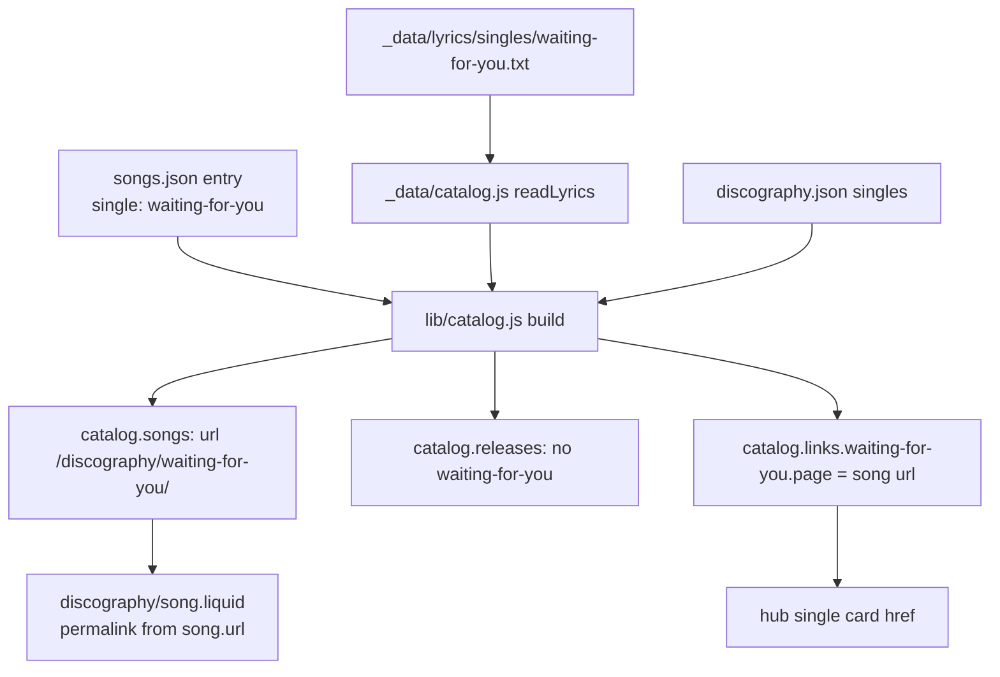

# Single Lyrics Design

**Spec**: `.specs/features/single-lyrics/spec.md`
**Status**: Draft

---

## Architecture Overview

The catalog builder learns a second kind of song parent. Today every `songs.json` entry names an `album` and the builder joins it to that album's track. An entry may now name a `single` instead. The builder joins it to `discography.singles`, gives the song the single's URL, and stops emitting a release page for that single. `discography/song.liquid` already paginates `catalog.songs`, so the page appears with no new template. A `song.single` flag switches the few album-specific strings.



**Approaches considered.** (1, chosen) Single songs live in `catalog.songs` with the single as their parent release, and one page template serves both kinds. (2) A separate `catalog.singleSongs` collection with its own page template. That would duplicate the lyrics bento wiring and every SEO block, so a future fix would have to land twice. (3) A lyrics panel inside `release.liquid`. Grilling Q3 rejected that layout.

---

## Code Reuse Analysis

### Existing Components to Leverage

| Component | Location | How to Use |
| --- | --- | --- |
| Song shell builder | `lib/catalog.js:94-127` | Generalize the parent lookup (album or single) |
| `albumCode` | `lib/catalog.js:18` | `WFY`, `TSWR` for the `-SINGLE` catalog code |
| `parseSections` / `sectionFamily` / `uplink` / `listenUrl` / `songLayout` | `lib/catalog.js` | Unchanged; they run on single songs too |
| Single fold loop | `lib/catalog.js:187-200` | Skip the release page when the single owns a song |
| `readLyrics` | `_data/catalog.js:6` | Already reads any `<dir>/<slug>.txt`; `singles/` is picked up as is |
| Song page + lyrics bento | `discography/song.liquid`, `_includes/discography/song-bento-*.liquid` | Same page; `song.single` branches for meta strings, JSON-LD, breadcrumbs |
| Breadcrumbs include | `_includes/seo/breadcrumbs.liquid` | Pass `crumb_release = song`, no `crumb_song` → 2 items |
| Song nav | `_includes/discography/song-nav.liquid` | Renders nothing when `prev`/`next` are null |

### Integration Points

| System | Integration Method |
| --- | --- |
| Hub single cards | `catalog.links[slug].page` already drives the href; it now holds the song URL (same string) |
| Sitemap | `collections.all`; the song page replaces the release page at the same URL |
| `release_click` tracking | Uplink and LISTEN NOW carry `data-disc-slug = song.listen.slug` = the single slug |

---

## Components

### Catalog builder (`lib/catalog.js`)

- **Purpose**: Build a song from either an album track or a single.
- **Changes**:
  - `const singles = new Map(discography.singles.map(s => [s.slug, s]))`.
  - For an entry with `single`: `parent = singles.get(song.single)`. If it is missing, throw `seo-discovery: <slug> references unknown single` (SLYR-04). `track = { position: 1, title: parent.title, duration: song.duration }`.
  - `url = releaseUrl(parent.slug)` for a single, else `/discography/<album>/<song>/`.
  - Lyrics key `singles/<slug>` for a single, else `<album>/<slug>`. The existing missing-file error is reused (SLYR-03).
  - `catalogCode`: `<albumCode(parent.title)>-SINGLE` for a single, else unchanged.
  - `cover`: `{ file: parent.cover, alt: '<title> single cover' }` for a single.
  - `album` holds the parent release's existing shape (`slug, title, year, url, cover, links`), so `listen.slug`, uplink and tracking keep working. A new field `single: true|false` marks the kind.
  - Prev/next is computed only among album siblings, so a single gets `null`/`null`.
  - In the singles loop, a single whose slug is some song's `single` gets `links[slug] = { page: song.url, tracks: {} }` and no `releasePage` (SLYR-05).
- **Reuses**: every existing helper.

### Song page (`discography/song.liquid` + includes)

- `permalink: "{{ song.url | remove_first: '/' }}index.html"`, valid for both kinds.
- `page_description`: add an `elsif song.single` fallback (SLYR-14) after `song.about`.
- `song-bento-meta.liquid`: when `song.single`, the tab is `SINGLE::<year>`, the eyebrow `Single // <year>`, and the line `<p class="song-album">Single · Released <year></p>` with no link (SLYR-07).
- JSON-LD: wrap `inAlbum` and `position` in `` (SLYR-15).
- Breadcrumbs: when `song.single`, `crumb_release = song` and no `crumb_song` (SLYR-16).
- The stack layout (`song.layout == 'stack'`) is used only by instrumentals and keeps its album wording. A single instrumental is out of scope.

---

## Data Models

### `songs.json` single entry

```json
{"slug": "waiting-for-you", "single": "waiting-for-you", "duration": 218,
 "about": "…",
 "links": {"apple": "https://music.apple.com/us/album/waiting-for-you/1793471043?i=1793471044"}}
```

`duration` lives here, not in `discography.json`, because DISC-19 pins `singles[].tracks` to `[]`.

### Lyrics files

`_data/lyrics/singles/<slug>.txt` (EN, rendered) and `<slug>.pt.txt` (PT, stored only), in the `[Label]` format.

---

## Error Handling Strategy

| Error Scenario | Handling | User Impact |
| --- | --- | --- |
| `single` names an unknown single | Build throws `seo-discovery: <slug> references unknown single` | Deploy blocked; no broken page ships |
| Single song without a lyrics file | Build throws the existing `has no lyrics file` error | Same |
| Two pages at one URL | Prevented by SLYR-05; Eleventy would also fail on the duplicate permalink | Same |

---

## Risks & Concerns

| Concern | Location (file:line) | Impact | Mitigation |
| --- | --- | --- | --- |
| Tests pin the old release list and song count (22 songs, 8 releases, release/index-link/output lists) | `tests/seo/catalog-data.test.cjs:9`, `tests/seo/catalog.test.cjs:49,73`, `tests/seo/songs-data.test.cjs:21`, `tests/seo/release.e2e.cjs:10`, `tests/seo/index-links.e2e.cjs:6`, `tests/seo/output.test.cjs:21` | They fail by design once the two release pages become song pages | Amend them to the new contract in the task that changes the behavior, and amend `seo-discovery` REL-01/SONG-01 to point here (L-004) |
| `fakeLyrics` keys songs by `${s.album}/${s.slug}` | `tests/seo/catalog.test.cjs:10` | A single entry gives `undefined/<slug>` and the build throws | Key single entries as `singles/<slug>` |
| `catalog.test.cjs:41` deep-equals `song.album`'s shape | `tests/seo/catalog.test.cjs:41` | An added field would break it | Keep `album`'s shape; put the kind on `song.single` |
| The lyrics bento is tested only on album songs | `tests/discography/song-bento.e2e.cjs:11` | A single-only regression would pass | New e2e on both single pages (L-037: the meta/dossier includes serve both kinds) |

---

## Tech Decisions

| Decision | Choice | Rationale |
| --- | --- | --- |
| Kind flag | `song.single` boolean; `song.album` = parent release | Smallest template diff; existing tracking reads `listen.slug` |
| Duration source | `songs.json` `duration` | DISC-19 forbids single tracklists |
| Permalink | Derived from `song.url` | One source of truth for both kinds |
