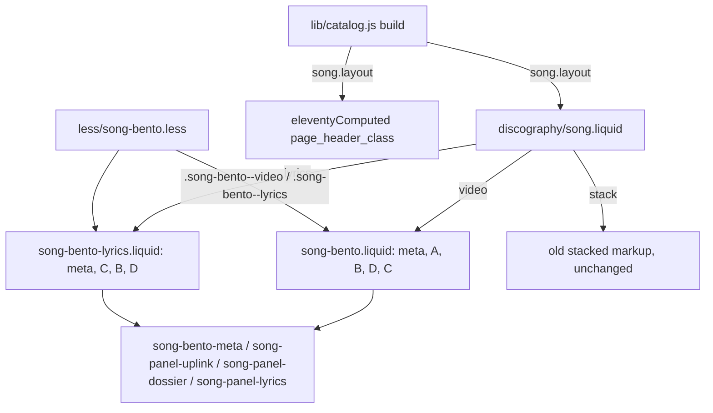

# Song Bento Without Video Design

**Spec**: `.specs/features/song-bento-no-video/spec.md`
**Status**: Approved

---

## Architecture Overview

One build-time field decides the layout of every song page; the panels of the video bento become partials that two compositions share.

### Approaches considered

1. **Shared panel partials + one composition per layout (chosen).** Each layout writes its own DOM order (video A, B, D, C; lyrics C, B, D) in a ten-line file; panel markup lives once.
2. One `song-bento.liquid` with `` around every panel. Two DOM orders in one file means duplicated or reordered blocks behind conditionals - harder to read than two short compositions.
3. Keep the video DOM order (B, D, C) and move C first with CSS grid only. Breaks NOVID-01/06 (DOM and phone order C, B, D) and reading order for screen readers.

---

## Code Reuse Analysis

| Component | Location | How to Use |
| --- | --- | --- |
| Video bento markup | `_includes/discography/song-bento.liquid` | Split into meta bar and panel partials; the file becomes the video composition |
| Lyrics / dossier partials | `_includes/discography/song-lyrics.liquid`, `song-dossier.liquid` | Included by the new panel partials unchanged (the stacked layout keeps using them) |
| Bento grid, HUD finish | `less/song-bento.less` | Same `.song-page--bento` scope; add a `--lyrics` grid and move the sticky rule per layout |
| QUICK PLAY style | `a.song-bento-quickplay` in `less/song-bento.less:69` | LISTEN NOW joins the same rule |
| Focus ring | `less/discography.less:225` (`.disc-page a:focus-visible`) | Already covers any anchor in the song shell |
| `release_click` | `assets/js/discography-core.js:17`, delegated from `[data-disc]` | LISTEN NOW sits inside `[data-disc]` and carries `data-disc-link` / `data-disc-slug` |
| `song.uplink` | `lib/catalog.js` | LISTEN NOW takes the `spotify` entry's URL |

### Integration Points

| System | Integration Method |
| --- | --- |
| Eleventy data | `song.layout` added in `build()`; templates read it |
| Base layout `<h1>` | `page_header_class` computed from `song.layout != 'stack'` |
| GTM | Existing `release_click` through `dataLayer` |

---

## Components

### `song.layout` (data)

- **Purpose**: One rule for which layout a song page uses.
- **Location**: `lib/catalog.js` (`build()`, plus exported `songLayout(song)`)
- **Interfaces**: `songLayout({ video, instrumental }): 'video' | 'lyrics' | 'stack'` - `video` when a video is set; otherwise `stack` when instrumental; otherwise `lyrics`.
  - `listenUrl(uplink): string | null` - URL of the `spotify` entry, else `null`; stored as `song.listenUrl`.
- **Reuses**: existing `build()` song object.

### Meta bar partial

- **Purpose**: The metadata bar for both bento layouts.
- **Location**: `_includes/discography/song-bento-meta.liquid`
- **Interfaces**: renders QUICK PLAY when `song.video`, else LISTEN NOW (`[data-song-listen]`, `class="song-bento-quickplay song-bento-listen"`, `fa-spotify`, `href=song.listenUrl`) when `song.listenUrl` is set, else no CTA.

### Panel partials

- **Location**: `_includes/discography/song-panel-uplink.liquid`, `song-panel-dossier.liquid`, `song-panel-lyrics.liquid` (Panel A stays inline in the video composition - only one layout uses it).
- Panel B and Panel D wrap their content in `.song-bento-sticky`; the stylesheet decides which one sticks per layout.
- Panel D wraps About and "Also" in `.song-bento-dossier`, adding `.song-bento-dossier--split` when `song.alsoReleasedAs.size > 0`.

### Compositions

- `song-bento.liquid` (video): meta, A, B, D, C inside `
` - DOM output identical to today apart from the two wrapper classes.
- `song-bento-lyrics.liquid` (new): meta, C, B, D inside `
`.

### Styles (`less/song-bento.less`)

- `.song-bento--lyrics`: areas `"c" "b" "d"`; at ≥ 992px `"c c c c b b" "d d d d d d"`.
- Sticky: `.song-bento--video .song-bento-panel--d .song-bento-sticky` and `.song-bento--lyrics .song-bento-panel--b .song-bento-sticky` at ≥ 992px, `top: 2rem`.
- `.song-bento-dossier--split` at ≥ 992px: `grid-template-columns: 4fr 2fr` with the same 2rem column gap as the bento (About/(About+Also) ≈ 0.66). `.song-bento--lyrics .song-about p { max-width: 70ch; }`.
- `a.song-bento-listen` shares the `a.song-bento-quickplay` rule (it carries both classes).

---

## Error Handling Strategy

| Error Scenario | Handling | User Impact |
| --- | --- | --- |
| Song without Spotify URL | Meta partial renders no CTA (NOVID-13) | Streaming still reachable in Panel B |
| Song without "Also released as" | No `--split` modifier; About capped at 70ch (NOVID-19) | Readable single column |
| Unlabeled lyrics (Tears of Blood) | Existing BENTO-27 behavior: no family class, no marker | Plain lyrics |

---

## Risks & Concerns

| Concern | Location (file:line) | Impact | Mitigation |
| --- | --- | --- | --- |
| Existing tests pin non-video pages to the old layout | `tests/discography/song-bento.e2e.cjs:139` (BENTO-02), `:180` (BENTO-08) | They fail by design once the lyrics layout ships | Narrow both to instrumental songs in the same task that renders the new layout, after amending BENTO-02/08 text (L-004) |
| Sticky rule today targets any `.song-bento-sticky` | `less/song-bento.less:36` | Wrapping Panel B in it would make B sticky on video pages too | Scope the rule by layout modifier; BENTO-33 test keeps video D sticky |
| Stale minified bundle shipped before (`5eb1729`) | `assets/css/discography.min.css` | Styles missing in production | Each style task commits the rebuilt bundle and asserts computed styles from the built site |

---

## Tech Decisions

| Decision | Choice | Rationale |
| --- | --- | --- |
| Where the layout rule lives | `song.layout` in `lib/catalog.js` | One unit-tested rule read by the wrapper, the header class and the composition switch, instead of three Liquid conditions |
| LISTEN NOW class | Carries both `song-bento-quickplay` and `song-bento-listen` | Same look by construction (NOVID-14); the hook stays distinct for tests and JS (QUICK PLAY JS binds `[data-song-quickplay]`, which LISTEN NOW lacks) |
