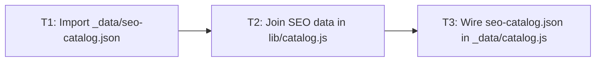
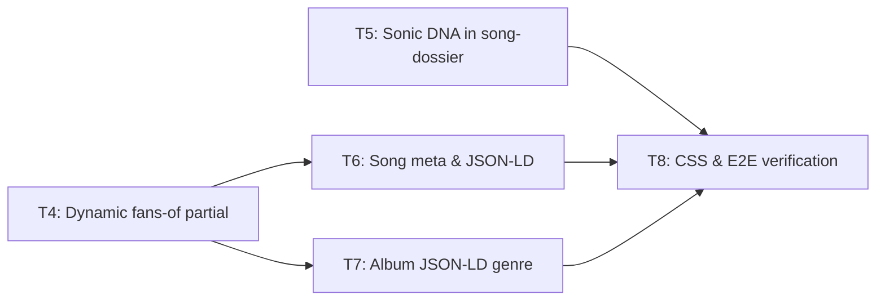

# Song Similar Bands & SEO Enrichment Tasks

## Test Coverage Matrix

> Generated from codebase, project guidelines, and spec - confirm before Execute. Guidelines found: none - strong defaults applied (sampled `tests/seo/catalog.test.cjs`, `tests/seo/output.test.cjs`, `tests/discography/song-bento.e2e.cjs`).

| Code Layer | Required Test Type | Coverage Expectation | Location Pattern | Run Command |
| --- | --- | --- | --- | --- |
| Importer & Data | unit | 24 tracks present, ✅-only bands, no MERT jargon in justification | `tests/seo/seo-catalog-data.test.cjs` | `npm run test:unit` |
| Domain / Catalog (`lib/catalog.js`) | unit | 1:1 to `BANDSEO-01`, `BANDSEO-05`; edge cases (1 band, duplicates, missing `seoCatalog`) | `tests/seo/catalog.test.cjs` | `npm run test:unit` |
| Templates & SEO Output | unit + e2e | Meta description, JSON-LD, `For fans of...`, `Sonic DNA`, fallback; all 3 song layouts + release | `tests/seo/output.test.cjs`, `tests/discography/seo-similar-bands.e2e.cjs` | `npm run test:unit` / `npx playwright test` |
| Styling (`less/discography.less`) | e2e | Build succeeds and rendered layout is visible without overflow across viewports | `tests/discography/seo-similar-bands.e2e.cjs` | `npm run build && npx playwright test tests/discography/seo-similar-bands.e2e.cjs` |

## Gate Check Commands

> Generated from codebase - confirm before Execute.

| Gate Level | When to Use | Command |
| --- | --- | --- |
| Quick | After tasks with unit tests only | `npm run test:unit` |
| Full | After tasks with e2e tests | `npm run test:unit && npm run less:build && npx playwright test tests/discography/seo-similar-bands.e2e.cjs tests/discography/seo.e2e.cjs tests/seo/head.e2e.cjs` |
| Build | After phase completion or final verification | `npm run build && npm run test:unit` |

---

## Task Breakdown

### Phase 1: Data & Catalog Model

### T1: Create local importer and `_data/seo-catalog.json`

**Status**: done
**Where**: `scripts/import-seo-catalog.cjs`
**Depends on**: none
**Tests**: `tests/seo/seo-catalog-data.test.cjs`
**Gate**: Quick
**Done when**: `scripts/import-seo-catalog.cjs` deterministically generates `_data/seo-catalog.json` with all 24 tracks, only `✅` bands, non-empty reference tracks, and clean editorial justifications without MERT layer/score strings; unit test in `tests/seo/seo-catalog-data.test.cjs` passes (`BANDSEO-01`, `BANDSEO-03`).

### T2: Add song SEO enrichment and album band aggregation to `lib/catalog.js`

**Status**: done
**Where**: `lib/catalog.js`
**Depends on**: T1
**Tests**: `tests/seo/catalog.test.cjs`
**Gate**: Quick
**Done when**: `build()` attaches `song.seo` (`primaryGenre`, `secondaryGenre`, `genres`, `bands`, `fansOf`, `keywords`) and `release.seo` (top 4 recurring `✅` bands ranked by frequency, max MERT score, name; unique genres), handles 1-band formatting and missing `seoCatalog` gracefully; unit tests in `tests/seo/catalog.test.cjs` pass (`BANDSEO-01`, `BANDSEO-05`, `BANDSEO-07`).

### T3: Pass `_data/seo-catalog.json` into `_data/catalog.js`

**Status**: done
**Where**: `_data/catalog.js`
**Depends on**: T2
**Tests**: `tests/seo/catalog-data.test.cjs`
**Gate**: Build
**Done when**: `_data/catalog.js` loads `seo-catalog.json` and passes it to `build()`; `npm run build && npm run test:unit` passes (`BANDSEO-01`).

### Phase 2: Templates, Styling & E2E Verification

### T4: Update `_includes/seo/fans-of.liquid` for song, release, and fallback

**Status**: pending
**Where**: `_includes/seo/fans-of.liquid`
**Depends on**: T3
**Tests**: `tests/discography/seo-similar-bands.e2e.cjs` (verified in T8)
**Gate**: Build
**Done when**: Partial renders `song.seo.fansOf` on song pages, `release.seo.fansOf` on album pages, and falls back to `For fans of Alter Bridge, Killswitch Engage and Avenged Sevenfold` elsewhere (`BANDSEO-02`, `BANDSEO-07`).

### T5: Render `Sonic DNA & Similar Artists` in `_includes/discography/song-dossier.liquid`

**Status**: pending
**Where**: `_includes/discography/song-dossier.liquid`
**Depends on**: T3
**Tests**: `tests/discography/seo-similar-bands.e2e.cjs` (verified in T8)
**Gate**: Build
**Done when**: Section renders primary/secondary genre badges and each `✅` band's name, reference tracks, and clean editorial justification across `video`, `lyrics`, and `stack` layouts (`BANDSEO-03`).

### T6: Enrich `page_description` and `MusicRecording` JSON-LD in `discography/song.liquid`

**Status**: pending
**Where**: `discography/song.liquid`
**Depends on**: T4
**Tests**: `tests/seo/output.test.cjs`
**Gate**: Quick
**Done when**: `page_description` includes `For fans of <✅ bands>` before `song.about` (or instrumental summary) within 160 chars, and `MusicRecording` JSON-LD includes `description`, `keywords`, and deduplicated `genre`; `tests/seo/output.test.cjs` passes (`BANDSEO-04`, `BANDSEO-06`).

### T7: Update `MusicAlbum` JSON-LD `genre` in `discography/release.liquid`

**Status**: pending
**Where**: `discography/release.liquid`
**Depends on**: T4
**Tests**: `tests/discography/seo-similar-bands.e2e.cjs` (verified in T8)
**Gate**: Build
**Done when**: `MusicAlbum` JSON-LD uses `release.seo.genres` when present and falls back to `["Hard Rock", "Heavy Metal", "Metalcore"]` otherwise (`BANDSEO-05`).

### T8: Style `.song-sonic-dna` in `less/discography.less` and add E2E verification

**Status**: pending
**Where**: `less/discography.less`
**Depends on**: T5, T6, T7
**Tests**: `tests/discography/seo-similar-bands.e2e.cjs`
**Gate**: Full
**Done when**: `.song-sonic-dna` is styled cleanly in `less/discography.less` and Playwright E2E tests in `tests/discography/seo-similar-bands.e2e.cjs` pass across `video`, `lyrics`, `stack`, `release`, `band`, and `home` pages verifying `✅`-only output and zero `⚠️` leakage (`BANDSEO-02`, `BANDSEO-03`, `BANDSEO-04`, `BANDSEO-05`, `BANDSEO-06`, `BANDSEO-07`).

---

## Execution Plan

### Phase 1: Data & Catalog Model

- [x] **T1** → **T2** → **T3**

### Phase 2: Templates, Styling & E2E Verification

- [ ] **T4**, **T5** (parallel after Phase 1) → **T6**, **T7** → **T8**
