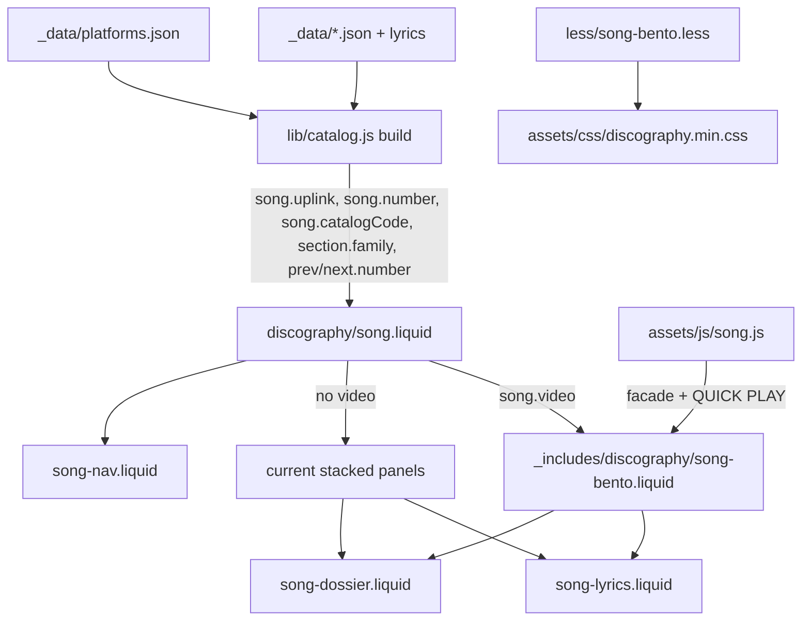

# Song Video Bento Design

**Spec**: `.specs/features/song-video-bento/spec.md`
**Status**: Draft

---

## Architecture Overview

Build-time data derivation in `lib/catalog.js` (unit-testable), thin Liquid templates, one new Less module, and a small extension of `assets/js/song.js`. The song page keeps one template (`discography/song.liquid`) that branches on `song.video`; content blocks used by both branches move into shared partials so lyrics, dossier and navigation render from one source.



### Approaches considered

| Approach | Verdict |
| --- | --- |
| **A. Branch inside `song.liquid` + shared partials + derived data in `lib/catalog.js`** | **Chosen.** One permalink/pagination source, logic unit-tested in Node, templates stay declarative. |
| B. A second paginated template for video songs (`song-video.liquid`) filtering `catalog.songs` | Duplicates front matter, SEO computed fields and JSON-LD; two pagination sources for one URL space. |
| C. Compute uplink order, labels and section families in Liquid | Liquid 6 has weak string helpers; logic becomes untestable outside e2e. |

---

## Code Reuse Analysis

### Existing Components to Leverage

| Component | Location | How to Use |
| --- | --- | --- |
| `.cyber-panel` / tab / corners vocabulary | `less/cyber-global.less` | Each Bento panel is a `.cyber-panel` with `.cyber-panel-tab` and `.cyber-panel-body` |
| `.cyber-link-btn` (+ `--primary`, `--compact`, `.cyber-link--{key}` brand hovers) | `less/cyber-links.less` | Panel B buttons; BENTO-23 is satisfied by the existing hover rules |
| `[data-disc-link]` click delegation (`release_click`) | `assets/js/discography.js:47` | Panel B anchors carry the same attributes inside the `[data-disc]` root |
| Video facade → iframe | `assets/js/song.js` | Extract `activate(facade)`; QUICK PLAY calls it |
| `.song-video-frame-box`, `.song-video*` | `less/discography.less:711` | Panel A frame; already 16:9 |
| `seo/fans-of` include | `_includes/seo/fans-of.liquid` | Metadata bar, unchanged text (GEN-05) |
| Lyrics / About / Also-released markup | `discography/song.liquid` | Moved verbatim into partials |
| Focus ring pattern `3px solid #fcee0a`, offset 4px | `less/home.less:626` | Same declaration in `song-bento.less` |

### Integration Points

| System | Integration Method |
| --- | --- |
| Eleventy data | `_data/catalog.js` passes `platforms.json` into `build()` |
| Base layout `<h1>` | `_layouts/base.html` appends `{{ page_header_class }}`; `song.liquid` computes it |
| CSS bundle | `less/pages/discography.less` imports `../song-bento.less` (song pages use `page_id: discography`) |
| GTM | `song_quick_play` pushed to `window.dataLayer` |

---

## Components

### Catalog derivations (`lib/catalog.js`)

- **Purpose**: Give templates every computed value they need.
- **Interfaces**:
  - `sectionFamily(label: string|null): 'verse'|'chorus'|'bridge'|'other'|null` - BENTO-27. `/^verse/i`→verse, `/^chorus/i`→chorus, `/^bridge/i` or `interlude`→bridge, other label→other, null→null. Exported.
  - `albumCode(title: string): string` - uppercase initials of the words (`Silicon Fortress`→`SF`). Exported.
  - `uplink(platforms, listen): Array<{key, name, icon, url, sub, primary}>` - BENTO-18..20. Order `spotify, apple, ytmusic, bandcamp` (primary) then `deezer, tidal, amazon, pandora`; url = `listen.links[key]`, entries without URL dropped; sub from `UPLINK_SUB[key]` when `listen.track[key]` exists else `platform.sub`. Exported.
  - Song fields added in `build()`: `number` (`'03'`), `catalogCode` (`'SF-TRACK-03'`), `uplink`, `sections[].family`, `prev/next.number`.
  - `build({ ..., platforms })` - `platforms` optional; `uplink` is `[]` when absent so existing callers stay valid.
- **Reuses**: `listen` object (SONG-07 fallback rule).

### `_includes/discography/song-lyrics.liquid`

- **Purpose**: The `[data-song-lyrics]` section (lyrics or instrumental), each `.song-lyrics-section` gaining `song-lyrics-section--{family}` when family is set.
- **Reuses**: Markup moved from `song.liquid`; SONG-04 tests guard it.

### `_includes/discography/song-dossier.liquid`

- **Purpose**: About (`[data-song-about]`) + Also released as (`[data-song-also]`), unchanged markup.

### `_includes/discography/song-nav.liquid`

- **Purpose**: `.song-nav` with `← Previous track // NN` / `Next track → // NN` eyebrows and titles; `rel` and hrefs unchanged. Rendered by `song.liquid` after the panels for every song.

### `_includes/discography/song-bento.liquid`

- **Purpose**: Video songs: `[data-song-meta]` bar and `[data-song-bento]` grid.
- **Structure**:
  - Meta bar: `.disc-release-art img` (cover), `Track NN // YYYY`, `Runtime M:SS`, album link, `Recommended intel` + fans-of include, `<a data-song-quickplay href="#song-video">Quick play</a>`.
  - Grid, DOM order A, B, D, C, each a `.cyber-panel.song-bento-panel--{a|b|c|d}`:
    - A `id="song-video"`: tab `PANEL A // VIDEO TRANSMISSION`; head `● OFFICIAL {type}` (`.song-bento-live` dot) + `REC::{id} // {type}`; existing facade; `<p class="song-bento-video-title">{title}</p>`; footer `SOURCE: YOUTUBE // {id}`.
    - B: tab `PANEL B // AUDIO UPLINK`; `.disc-links` with `song.uplink` primary anchors, `.disc-links--secondary` with compact ones; footer `STATUS: ONLINE // ALL NODES ACTIVE`.
    - D: tab `PANEL D // SONG DOSSIER`; `.song-bento-sticky` wrapping the dossier partial; footer `CATALOG: {catalogCode} // ALL EDITIONS LISTED`.
    - C: tab `PANEL C // LYRICS TERMINAL`; head `[N SECTIONS]` + `HUD.LOG::LYR_NN`; lyrics partial.

### `less/song-bento.less`

- **Purpose**: Grid, responsive stacking, HUD finish.
- **Key rules**:
  - Tabs use `font-family: SiliconFont` (Mars Mission, already declared in `less/typography.less`); badge h1 uses `insaneFont`.
  - `.song-bento { display: grid; grid-template-columns: 1fr; grid-template-areas: "a" "b" "d" "c"; }`; `@media (min-width: 992px) { grid-template-columns: repeat(6, 1fr); areas: "a a a a b b" "c c c d d d"; }`.
  - Panel B primary `.disc-links` 2 columns below 992px, 1 column at ≥ 992px.
  - `.song-bento-sticky { position: sticky; top: 2rem; }` at ≥ 992px only.
  - Panel bodies: `background-color: rgba(10,10,10,.85)`, 25px cyan grid via two `linear-gradient`s with `background-size: 25px 25px`.
  - Markers: `.song-lyrics-section--{family} h3::before` square, colors per BENTO-28; chorus `p { font-style: italic; }`.
  - Every element in scope: no `border-radius` (override the `50%` tab-icon/dot rules with square shapes).
  - `:focus-visible` ring on `[data-song-quickplay]`, `.cyber-link-btn`, `[data-song-video]`, `.song-nav-link`.
  - `@media (prefers-reduced-motion: reduce) { [data-song-bento] *, [data-song-meta] * { animation: none !important; } }`.
- **Scoping**: all selectors under `.song-page--bento`, so non-video pages are pixel-identical except the navigation bar.

### `assets/js/song.js`

- **Purpose**: Facade activation + QUICK PLAY.
- **Interfaces**: `activate(facade)` (existing body); QUICK PLAY click → `preventDefault`, push `{event:'song_quick_play', song}`, `panel.scrollIntoView({behavior: reduced ? 'auto' : 'smooth', block: 'start'})`, then `activate` the facade if it is still in the DOM (BENTO-12).

---

## Data Models

```typescript
interface UplinkEntry { key: string; name: string; icon: string; url: string; sub: string; primary: boolean }
interface SongPage /* additions */ {
  number: string            // '03'
  catalogCode: string       // 'SF-TRACK-03'
  uplink: UplinkEntry[]
  sections: { label: string|null; lines: string[]; family: 'verse'|'chorus'|'bridge'|'other'|null }[]
  prev: { title: string; url: string; number: string } | null
  next: { title: string; url: string; number: string } | null
}
```

---

## Error Handling Strategy

| Error Scenario | Handling | User Impact |
| --- | --- | --- |
| JavaScript disabled | Facade and QUICK PLAY are plain links (`watch?v=`, `#song-video`) | Video opens on YouTube / page jumps to Panel A |
| Platform without URL | Dropped from `uplink` | No dead button |
| `matchMedia` missing | Treated as no reduced-motion preference | Smooth scroll |

---

## Risks & Concerns

| Concern | Location (file:line) | Impact | Mitigation |
| --- | --- | --- | --- |
| SONG-07 e2e asserts `platforms.json` order for every song | `tests/seo/song.e2e.cjs` (SONG-07 block) | Fails by design on video pages | T7 updates the expectation for video songs to the uplink order; non-video songs keep the old assertion |
| SONG-10 unit test uses `deepEqual` on prev/next | `tests/seo/catalog.test.cjs:134` | Adding `number` breaks it | T2 updates the expectation with the new field |
| `border-radius: 50%` on tab icons and dots | `less/cyber-global.less:145`, `less/discography.less:121` | BENTO-36 fails inside Bento | `song-bento.less` overrides within scope |
| `[data-disc]` root required for click tracking | `assets/js/discography.js:3` | Lost `release_click` if Bento sits outside | Bento stays inside the existing `.disc-shell[data-disc]` |
| Video title rendered twice could create a second link named after it | `tests/seo/video.e2e.cjs` SONG-11 | Duplicate accessible name | Title below the frame is a `<p>`, never a link (BENTO-16) |

---

## Tech Decisions

| Decision | Choice | Rationale |
| --- | --- | --- |
| Where the Bento CSS lives | `less/song-bento.less` imported by the discography page bundle | Keeps `core.min.css` under its 200 KB budget (PERF-17) |
| h1 badge hook | `page_header_class` front-matter variable in `base.html` | Base layout owns the only `<h1>` (SONG-03) |
| Panel DOM order A, B, D, C | Grid areas reorder C/D on desktop | Natural mobile reading order without `order` hacks and with correct tab order |
